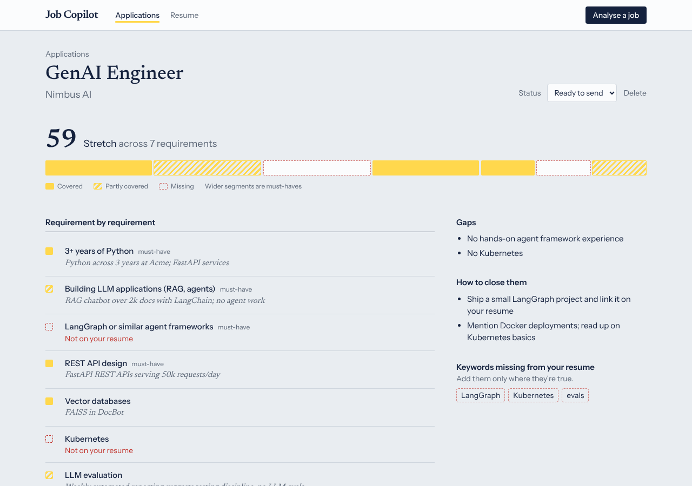
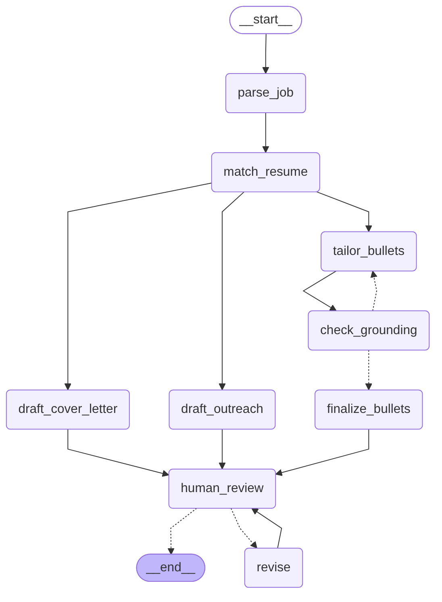

# Job Application Copilot

An AI agent that reads a job posting, compares it to your resume, and drafts a tailored application: a **fit score with gap analysis**, **rewritten resume bullets**, a **cover letter** and a **recruiter message**. It **fact-checks its own rewrites** so it never invents experience, and it **waits for your review** before anything is final.

Built with **LangGraph**, **LangChain**, **OpenAI**, **FastAPI**, **SQLite** and **Next.js**, with tests, evals, Docker and CI.

> Status: backend ✅ · web app ✅ · deployment 🚧



The bar under the score is the score's breakdown: one segment per job requirement (must-haves are wider), filled when your resume covers it, hatched when it partly does, dashed red when it's missing. In the rewritten bullets, the highlighted words are the ones the agent added.

---

## How the agent works



| Node | What it does |
|---|---|
| `parse_job` | Turns a raw job post into structured requirements (must-have vs nice-to-have) + ATS keywords |
| `match_resume` | The LLM classifies each requirement as **strong / partial / missing** with evidence; **code** computes the score |
| `tailor_bullets` → `check_grounding` | Rewrites resume bullets for the role, then a second LLM pass fact-checks them. Ungrounded rewrites trigger a retry with feedback (max 2), and any that still fail are dropped |
| `draft_cover_letter`, `draft_outreach` | Run **in parallel** with the bullet loop (fan-out / fan-in) |
| `human_review` | `interrupt()` pauses the graph. State is checkpointed to SQLite, so you can come back hours later |
| `revise` | Applies your feedback to one document and loops back to review |

## Design decisions (the interesting part)

- **Deterministic scoring.** Asking an LLM to "rate fit 0–100" gives noisy, unexplainable numbers. Here the LLM only labels each requirement, and a weighted formula (must-have ×2, strong = 1, partial = 0.5) computes the score. Two missing must-haves cap it at 59. It's stable, explainable and unit-tested.
- **Two layers of hallucination defence.** (1) A code check: every rewrite's `original` must exist verbatim on the resume. (2) An LLM fact-checker that flags new tools, numbers or scope. Failures feed back into a self-correction loop.
- **Human-in-the-loop with durable state.** LangGraph's `interrupt` + `SqliteSaver` means each application is a resumable thread. The REST API just resumes it with `Command(resume=...)`.
- **Prompt-injection hygiene.** Resumes and job posts are untrusted input. They're wrapped in `<resume>`/`<job>` tags, and system prompts tell the model to ignore instructions inside them.
- **Provider-agnostic, testable LLM layer.** Nodes call `llm.structured(system, user, Schema)`. Tests inject a deterministic `FakeLLM`, so the whole graph, including retries and interrupts, is tested offline in under 2 seconds.

## Quickstart

**Everything with Docker:**

```bash
cp backend/.env.example backend/.env   # add your OPENAI_API_KEY
docker compose up --build              # web: http://localhost:3000  API: http://localhost:8000/docs
```

**Or run each part locally.** Backend:

```bash
cd backend
python -m venv .venv && source .venv/bin/activate
pip install -e ".[dev]"
cp .env.example .env          # add your OPENAI_API_KEY
uvicorn app.main:app --reload
```

Frontend (in a second terminal):

```bash
cd frontend
cp .env.example .env.local
npm install && npm run dev    # http://localhost:3000
```

Open http://localhost:8000/docs for interactive API docs. Using the API directly:

```bash
# 1. upload resume (PDF or text)
curl -F file=@resume.pdf localhost:8000/api/resumes

# 2. analyse a job; runs the agent and pauses for review
curl -X POST localhost:8000/api/applications -H 'content-type: application/json' \
  -d '{"resume_id": 1, "job_text": "<paste the job description>"}'

# 3. ask for a revision, or approve
curl -X POST localhost:8000/api/applications/1/review -H 'content-type: application/json' \
  -d '{"action": "revise", "target": "cover_letter", "feedback": "shorter, mention my RAG project"}'
curl -X POST localhost:8000/api/applications/1/review -d '{"action":"approve"}' -H 'content-type: application/json'

# 4. track it
curl -X PATCH localhost:8000/api/applications/1 -H 'content-type: application/json' -d '{"status":"applied"}'
```

## API

| Method | Path | |
|---|---|---|
| `POST` | `/api/resumes` | Upload PDF/TXT (`file`) or `text`; parsed into a structured profile |
| `GET` | `/api/resumes` | List resumes |
| `POST` | `/api/applications` | Run the agent on a job post |
| `POST` | `/api/applications/stream` | Same, streamed as server-sent events (one per finished node) |
| `POST` | `/api/applications/{id}/review` | `{"action": "approve"}` or `{"action": "revise", "target": "bullets"\|"cover_letter"\|"outreach", "feedback": "..."}` |
| `GET` | `/api/applications[?status=]` | Tracker list |
| `GET / PATCH / DELETE` | `/api/applications/{id}` | Details, update status/notes, delete |
| `GET` | `/api/graph` | Mermaid diagram of the agent |

## Testing & evaluation

```bash
pytest -q                  # 17 offline tests: scoring, graph paths, grounding loop, HITL, API
python -m evals.run_evals  # real-LLM eval on a golden set (needs OPENAI_API_KEY)
```

The eval suite checks each case for: verdict in the expected range, expected gaps surfaced, rewrites grounded in real bullets, and no technologies invented. CI runs backend lint + tests + Docker build and frontend lint + build on every push, plus evals when the `OPENAI_API_KEY` secret is set.

**Tracing:** set `LANGSMITH_TRACING=true` and `LANGSMITH_API_KEY` in `.env`, and every graph run appears in LangSmith with per-node latency and token cost.

## Project structure

```
backend/
  app/
    agent/        graph.py · nodes.py · prompts.py · scoring.py · state.py
    main.py       FastAPI routes
    db.py         SQLModel tables (resumes, applications)
    llm.py        LLM client interface (OpenAI / fake)
    schemas.py    Pydantic models = LLM structured outputs
  tests/          offline tests with FakeLLM
  evals/          golden cases + eval runner
frontend/
  app/            Next.js routes: board, resume, new, applications/[id]
  components/     RequirementStrip, ApplicationView, UI bits
  lib/            typed API client + SSE reader, word diff
docker-compose.yml
```

## Roadmap

- [x] Next.js frontend: resume upload, bullet diff, review/revise, application board
- [x] Streaming progress (SSE) per graph node
- [ ] Edit drafts inline before approving
- [ ] Fetch job posts from a URL
- [ ] Deploy (Render/Railway + Vercel) with Postgres
- [ ] Export tailored resume as PDF/DOCX
- [ ] Interview-prep node: likely questions + STAR answers from your experience
