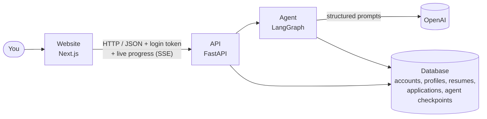
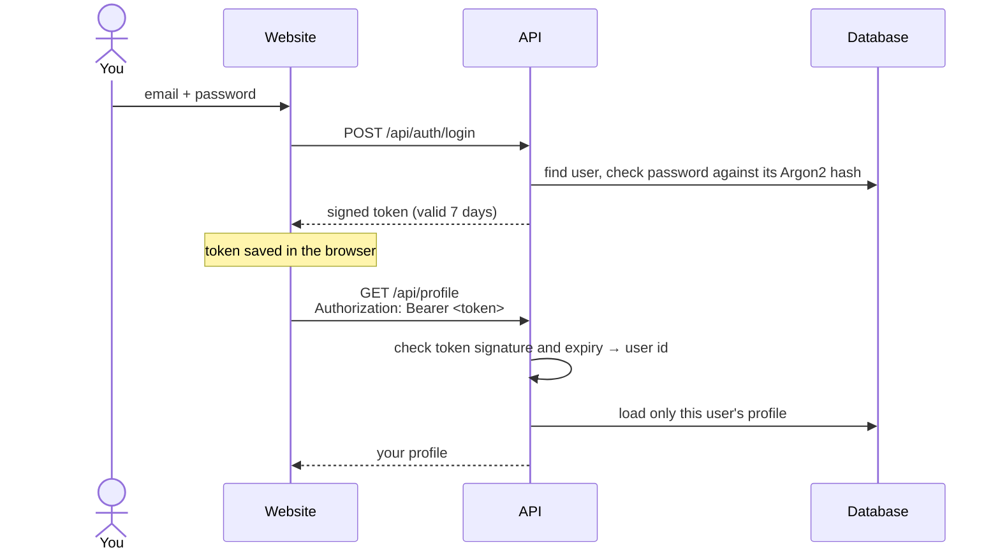
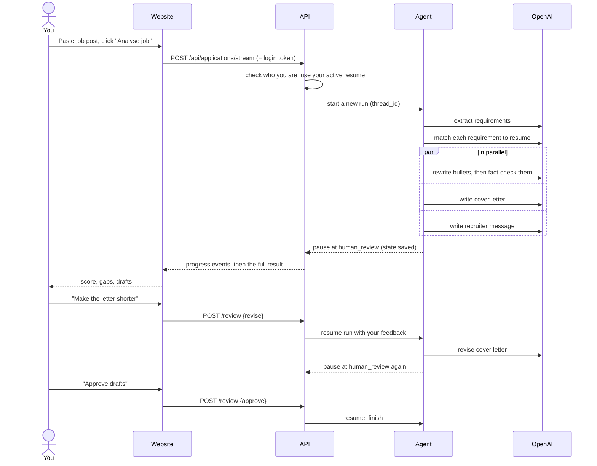

# How it works

This page explains the big picture: which parts exist, how they talk to each other, and what happens when you analyse a job.

## The parts

| Part | Folder | What it does |
|---|---|---|
| Website | `frontend/` | The pages you use. Holds no data of its own; everything comes from the API. |
| API | `backend/app/main.py`, `backend/app/routers/` | Receives requests from the website, checks who is logged in, runs the agent, saves results. One file per topic: `auth`, `profile`, `resumes`, `applications`. |
| Accounts | `backend/app/auth.py` | Password hashing and login tokens (see below). |
| Profile | `backend/app/profile_schema.py` | Every field an application form might ask, and which ones are required before applying. |
| Agent | `backend/app/agent/` | The step-by-step AI workflow (described below). |
| LLM client | `backend/app/llm.py` | The only place that talks to OpenAI. Everything else asks it for typed results. |
| Database | `backend/app/db.py`, `backend/migrations/` | Tables for users, profiles, saved answers, resumes and applications. Alembic migrations create and upgrade them. |
| Checkpoints | `backend/app/checkpointer.py` | A saved copy of each agent run, so it can pause for your review and continue later. |

## Accounts and login

- **Passwords are never stored.** Only an Argon2 hash is saved: a one-way scramble that can check a password but can't be turned back into it.
- **The token** is a JWT signed with `JWT_SECRET`. It says "user 42, valid until next week". Anyone without the secret can't forge one.
- **Every table has a `user_id`**, and every query filters by it. Asking for someone else's application, resume or answer returns 404, exactly like an id that doesn't exist.
- **A wrong email and a wrong password get the same error**, so the login form can't be used to find out who has an account.

## The profile

Filled in once, used for every application. All fields are optional, so you can save as you go. The ones marked ✱ are needed before the app can apply for you (the profile page lists what's still missing).

| Section | Fields |
|---|---|
| Personal | first name ✱, last name ✱, preferred name, email ✱, phone ✱, city ✱, state, country, LinkedIn, GitHub, portfolio |
| Education | degrees (degree, field, college, start/end year, CGPA or %), class 10 and 12 percentages |
| Work | total experience (years), current company, current title, key skills |
| Job preferences | job titles ✱, locations ✱, remote/hybrid/onsite, job types, experience level, salary range (LPA), companies to exclude |
| Common answers | notice period ✱, serving notice?, last working day, current salary (LPA), expected salary ✱ (LPA), willing to relocate, authorised to work in India, needs visa sponsorship, languages |
| Optional | date of birth, gender, disability, veteran status (each can be "prefer not to say") |
| Saved answers | answers to any other form question, reused next time |
| Resume ✱ | the original file is kept, so it can be attached to applications |

When you upload a resume, empty profile fields (name, phone, city, links, current job, skills) are filled from it. Anything you've already typed is never overwritten.

## What happens when you analyse a job

## The agent, step by step

The agent is a **graph**: boxes are steps (called *nodes*), arrows say what runs next. LangGraph runs it, saves the state after every step, and lets it pause.

| Step | File | What it does |
|---|---|---|
| `parse_job` | `nodes.py` | Turns the raw job post into a list of requirements, each marked must-have or nice-to-have. |
| `match_resume` | `nodes.py` + `scoring.py` | The AI labels each requirement strong / partial / missing, with evidence from your resume. Then plain code turns those labels into the score. |
| `tailor_bullets` | `nodes.py` | Rewrites your most relevant resume bullets using the job's wording. |
| `check_grounding` | `nodes.py` | A second AI pass checks the rewrites don't claim anything your original bullet doesn't support. If one does, it goes back to `tailor_bullets` with the reasons (at most 2 tries). |
| `finalize_bullets` | `nodes.py` | Drops any rewrite that still failed the fact-check. |
| `draft_cover_letter`, `draft_outreach` | `nodes.py` | Write the cover letter and recruiter message. These run at the same time as the bullet steps. |
| `human_review` | `nodes.py` | Pauses and waits for you. |
| `revise` | `nodes.py` | Applies your feedback to one document, then goes back to review. |

## How the score is calculated

The AI never invents the number. It only labels each requirement, and this formula (in `backend/app/agent/scoring.py`) does the rest:

- Must-haves count **2 points**, nice-to-haves **1 point**.
- Strong match earns the full points, partial earns **half**, missing earns **zero**.
- Score = points earned ÷ points possible × 100.
- If **two or more must-haves are missing**, the score is capped at 59.

| Score | Verdict |
|---|---|
| 80+ | Strong fit |
| 65–79 | Good fit |
| 45–64 | Stretch |
| below 45 | Poor fit |

## Where the data lives

Everything is in one database, set by `DATABASE_URL`:

| | On your computer | In production (Render) |
|---|---|---|
| Database | SQLite file `backend/data/copilot.db` | Postgres (Neon or Supabase, picked at deploy time) |
| Agent checkpoints | separate SQLite file `backend/data/checkpoints.db` | same Postgres database, LangGraph's own tables |
| Your OpenAI key, `JWT_SECRET` | `backend/.env` (never committed) | Render's environment settings |

| Table | Holds |
|---|---|
| `user` | email and password hash |
| `profile` | one per user: all profile sections as JSON, and which resume is active |
| `savedanswer` | extra form questions and your answers |
| `resume` | original file, extracted text, parsed profile |
| `application` | each job you analysed: status, score, notes, and the `thread_id` linking it to its agent checkpoint |

**Changing tables:** edit `app/db.py`, then run `alembic revision --autogenerate -m "what changed"` in `backend/` and review the generated file in `migrations/versions/`. The API applies pending migrations when it starts. Alembic only manages the tables above and ignores LangGraph's checkpoint tables (a test makes sure of it).
