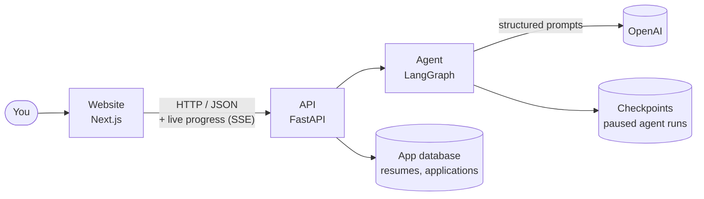
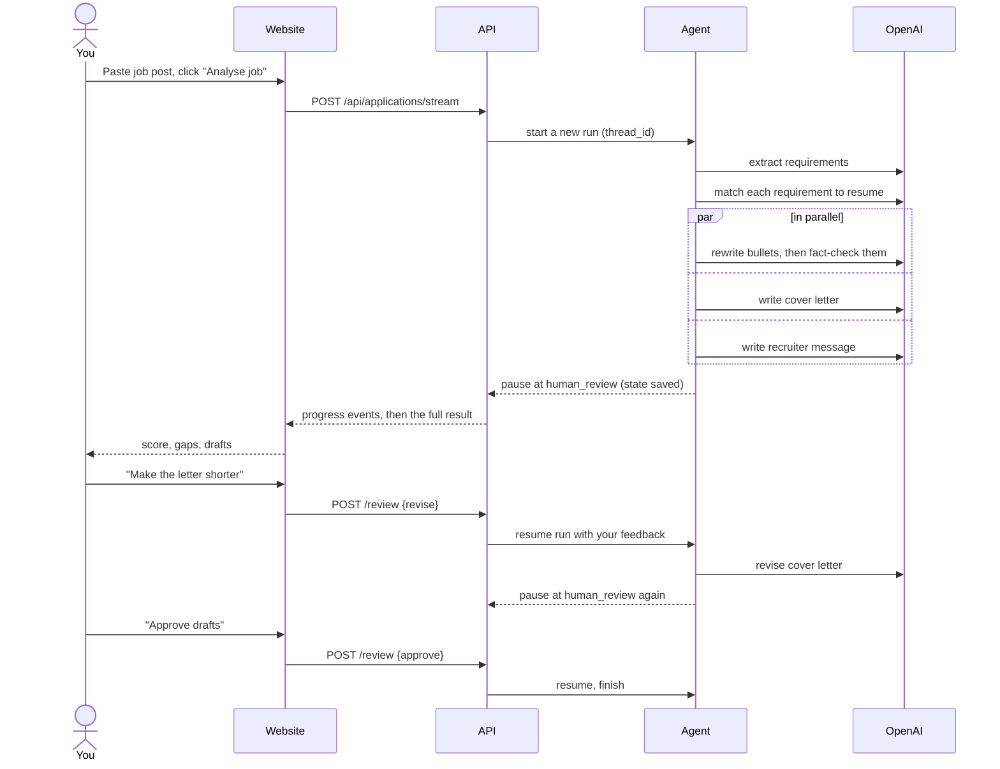
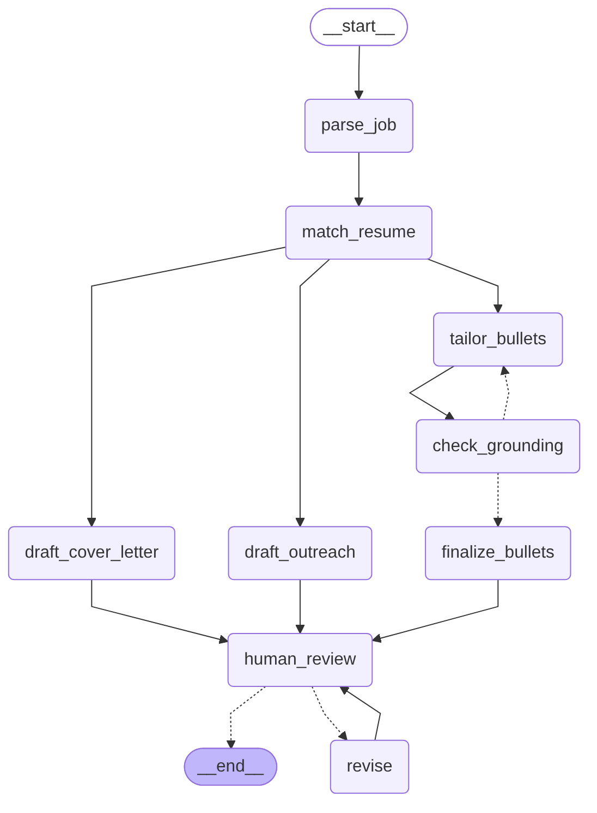

# How it works

This page explains the big picture: which parts exist, how they talk to each other, and what happens when you analyse a job.

## The parts

| Part | Folder | What it does |
|---|---|---|
| Website | `frontend/` | The pages you use. Holds no data of its own; everything comes from the API. |
| API | `backend/app/main.py` | Receives requests from the website, runs the agent, saves results. |
| Agent | `backend/app/agent/` | The step-by-step AI workflow (described below). |
| LLM client | `backend/app/llm.py` | The only place that talks to OpenAI. Everything else asks it for typed results. |
| App database | `backend/app/db.py` | Your resumes and the list of applications with their status. |
| Checkpoints | (SQLite file) | A saved copy of each agent run, so it can pause for your review and continue later. |

## What happens when you analyse a job

## The agent, step by step

The agent is a **graph**: boxes are steps (called *nodes*), arrows say what runs next. LangGraph runs it, saves the state after every step, and lets it pause.

| Step | File | What it does |
|---|---|---|
| `parse_job` | `nodes.py` | Turns the raw job post into a list of requirements, each marked must-have or nice-to-have. |
| `match_resume` | `nodes.py` + `scoring.py` | The AI labels each requirement strong / partial / missing, with evidence from your resume. Then plain code turns those labels into the score. |
| `tailor_bullets` | `nodes.py` | Rewrites your most relevant resume bullets using the job's wording. |
| `check_grounding` | `nodes.py` | A second AI pass checks the rewrites don't claim anything your original bullet doesn't support. If one does, it goes back to `tailor_bullets` with the reasons (at most 2 tries). |
| `finalize_bullets` | `nodes.py` | Drops any rewrite that still failed the fact-check. |
| `draft_cover_letter`, `draft_outreach` | `nodes.py` | Write the cover letter and recruiter message. These run at the same time as the bullet steps. |
| `human_review` | `nodes.py` | Pauses and waits for you. |
| `revise` | `nodes.py` | Applies your feedback to one document, then goes back to review. |

## How the score is calculated

The AI never invents the number. It only labels each requirement, and this formula (in `backend/app/agent/scoring.py`) does the rest:

- Must-haves count **2 points**, nice-to-haves **1 point**.
- Strong match earns the full points, partial earns **half**, missing earns **zero**.
- Score = points earned ÷ points possible × 100.
- If **two or more must-haves are missing**, the score is capped at 59.

| Score | Verdict |
|---|---|
| 80+ | Strong fit |
| 65–79 | Good fit |
| 45–64 | Stretch |
| below 45 | Poor fit |

## Where the data lives

| Data | Where | Notes |
|---|---|---|
| Resumes, applications, statuses, notes | App database (`DATABASE_URL`) | SQLite file locally. |
| Agent runs (drafts, match report, review history) | Checkpoint database (`CHECKPOINT_DB_PATH`) | SQLite file locally. Linked to an application by its `thread_id`. |
| Your OpenAI key | `backend/.env` | Never committed to Git. |

> Hosting note: free Render servers wipe local files on restart, so before deploying we'll move both databases to a hosted Postgres. See [decisions.md](decisions.md).
